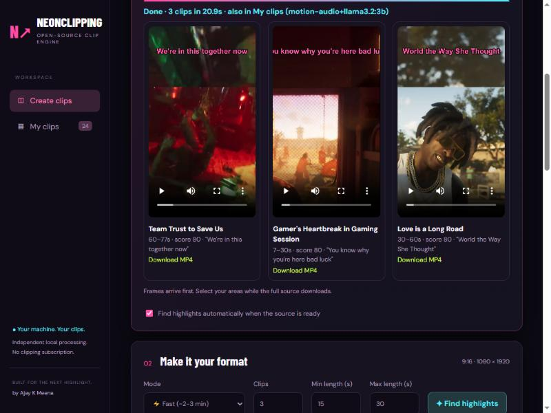

# NeonClipping

**Paste a link. Get captioned 9:16 clips in about two minutes. Free, local, open-source.**

NeonClipping turns long YouTube / Twitch / Kick videos (or your own MP4) into vertical, captioned clips with a title and hook for each. Everything runs on your machine: no account, no subscription, no upload.

[](https://github.com/iamajmeena/neonclipping) [](https://www.instagram.com/iamajmeena/)

**Made by [Ajay K Meena](https://www.instagram.com/iamajmeena/)** (Director, DOP, colorist, DaVinci Resolve educator, Jaipur). If NeonClipping saves you time, please ⭐ star the repo and follow [@iamajmeena](https://www.instagram.com/iamajmeena/) on Instagram.



📘 **Guides (Hindi + English, PDF):** [docs/NeonClipping-Guide-EN-HI.pdf](docs/NeonClipping-Guide-EN-HI.pdf)

## How it finds good moments

Two modes, one button.

**⚡ Fast mode (default, videos over 10 min)** copies the trick that makes the fastest clippers fast: never look at the whole video.

1. Download **audio only** (79 MB for an 85-minute video, about 10 s).
2. Take the transcript for free from YouTube's own captions (word-timed). No speech model needed. For other sources a local Whisper model is used as the fallback.
3. Score the whole audio track for *sudden loudness jumps* (vs a 2-minute local baseline), *raised voices* (2–4 kHz energy) and quiet-to-loud transitions.
4. Take the best moments, read each one's transcript with a local LLM (Ollama) and let it score the moment, write a title and a hook. Snap the start and end to sentence boundaries inside your Min/Max length.
5. Download **only the chosen sections** of the video (not the whole file), trim exactly by matching their sound to the audio track, and render 1080x1920 clips with burned-in captions.

**🔬 Deep mode** downloads the whole video, adds optical-flow motion (OpenCV Farneback: fast objects, impacts, camera whips) and cut density to the audio signals, shortlists 4× more candidates and gives the LLM 15 seconds of context before and after each one.

Measured on one machine (RTX 2060, 16 threads), Fast mode, 3 clips each:

| Source | Time |
|---|---|
| 85-minute YouTube stream (YouTube captions) | **97 s** |
| 3-hour Twitch VOD (no captions, local speech model) | **136 s** |
| 90-second YouTube trailer | 21 s |
| 90-second local MP4 | 14 s |

Your numbers depend on network and CPU.

## Features

- One-click **Make clips**, live progress, clips appear one by one with preview and MP4 download.
- **Min / Max clip length** (e.g. 30–80 s). Clips end on a sentence.
- **Facecam position presets** (top-left, top-right, bottom-left, bottom-right, bottom-centre, none) for the usual streamer layouts, remembered between sessions. Or draw the face and gameplay boxes yourself in the editor.
- Layouts: face + gameplay stack, blurred fill, fill screen, gameplay only.
- Caption styles: GTA Neon, Impact, Clean. Word-timed, editable words, SRT export, Hindi/Hinglish and English.
- Optical-flow motion + audio highlight ranking, frame-accurate NVENC export (falls back to x264).
- Nothing leaves your computer. The server binds to `127.0.0.1` only.

## Install

Requirements: Python 3.10+, FFmpeg on PATH. Optional but recommended: [Ollama](https://ollama.com) with `ollama pull llama3.2:3b` for AI titles, hooks and scores (without it clips are picked by the audio/motion score), and an NVIDIA GPU for NVENC and faster-whisper.

```bash
git clone https://github.com/iamajmeena/neonclipping
cd neonclipping
# Windows
./run.ps1
# Linux / macOS
./run.sh
```

Open <http://127.0.0.1:8770>, paste a link, press **⚡ Make clips**.

Optional GPU speech model support (only used when a video has no YouTube captions):

```bash
.venv/bin/pip install nvidia-cublas-cu12 "nvidia-cudnn-cu12==9.*"
```

Set `NEONCLIPPING_CPU=1` to force CPU.

## How it is built

| File | Job |
|---|---|
| `app.py` | FastAPI server, `/make` pipeline, export, library |
| `smart.py` | Moment scoring: transcript + local LLM, sentence snapping |
| `highlights.py` | Audio-jump / shout / optical-flow / cut ranking, parallel decode |
| `captions_yt.py` | YouTube word-timed captions (json3) parser |
| `captions.py` | Local Whisper (GPU first, CPU fallback), ASS/SRT styles |
| `standalone.py`, `previews.py` | Link import, early preview frames |

## Honest limits

- Highlight picking is a heuristic plus a small local LLM. It finds loud, energetic, quotable moments, not guaranteed "viral" ones. Review before posting.
- The LLM sees text only. It cannot see the screen.
- Without YouTube captions (Twitch VODs, uploaded files) a speech model must transcribe each candidate, which is slow on CPU.
- Auto-caption accuracy follows the source: YouTube's auto captions are imperfect, especially Hinglish.
- Deep mode was verified on a short video only; on multi-hour videos it downloads the whole file first and is slow by design.
- Facecam presets are starting points, not detection: if you pick Bottom-right but the cam is bottom-left, the top half of the clip will show the wrong area. Pick the right corner or draw your own boxes.

## Credits and inspiration

Design ideas studied from open-source clippers: [PeakCut](https://github.com/haziqahmedqasmi/PeakCut) (audio-first download, captions as transcript, section download), [ClipCutter](https://github.com/curtyo18/ClipCutter), [content-ai](https://github.com/buddah0/content-ai), and the Growlance live-clipper script. Built on FFmpeg, yt-dlp, FastAPI, faster-whisper, OpenCV, Ollama.

## License

MIT. See [LICENSE](LICENSE).
